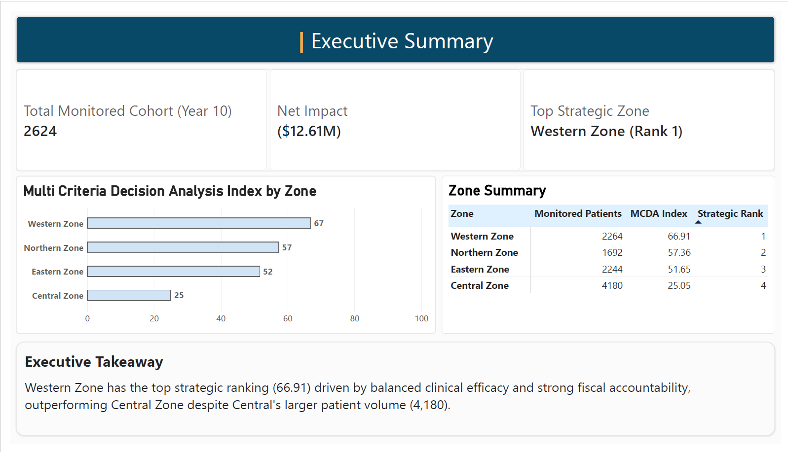
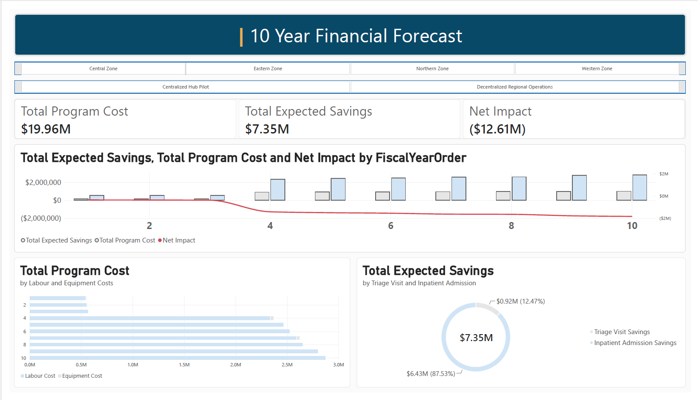
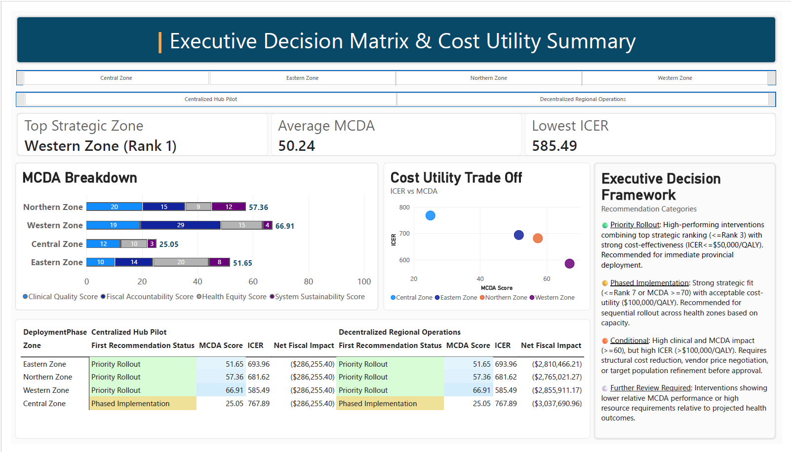

# 📊 Healthcare Regional Evaluation & Financial Decision Matrix

An executive-level Power BI analytics suite designed to evaluate regional deployment models across healthcare delivery zones. This dashboard synthesizes 10-year financial forecasting with Multi-Criteria Decision Analysis (MCDA) and incremental cost-effectiveness metrics (ICER) to guide strategic healthcare investments.

---

## 💡 Executive Summary

  

### Key Takeaways
* **Top Performing Region:** **Western Zone (Rank 1)** achieved the highest MCDA score (**66.91**), driven by superior clinical quality scores and strong fiscal accountability[cite: 3].
* **Volume vs. Strategic Alignment:** Western Zone outperformed Central Zone strategically despite Central Zone managing a significantly larger patient volume (**4,180** patients vs. **2,264** in Western Zone)[cite: 3].
* **Cohort Scope:** Tracked a total monitored cohort of **2,624 patients** (Year 10 projection) across four key operational zones (Central, Eastern, Northern, Western)[cite: 3].

---

## 📈 10-Year Financial Forecast

  

### Financial Dynamics & Insights
* **Program Investment:** Total estimated 10-year program cost stands at **$19.96M** across labor and equipment expenses[cite: 1].
* **Direct Cost Offset:** Anticipated total savings reach **$7.35M**, heavily weighted toward **Inpatient Admission Savings ($6.43M / 87.53%)** relative to Triage Visit Savings ($0.92M / 12.47%)[cite: 1].
* **Net Fiscal Impact:** Net program impact resolves to **($12.61M)** over the 10-year period, reflecting continuous capital and operational investment across deployment phases[cite: 1].

---

## 🧭 Decision Framework & Cost-Utility Trade-Offs

  

### MCDA Score Decomposition
Evaluation criteria evaluate strategic viability across four weighted pillars[cite: 2]:
1. **Clinical Quality Score**[cite: 2]
2. **Fiscal Accountability Score**[cite: 2]
3. **Health Equity Score**[cite: 2]
4. **System Sustainability Score**[cite: 2]

### Recommendation Categories & Zone Status
* 🟢 **Priority Rollout (Western, Northern, Eastern Zones):** High-performing interventions with top strategic rankings ($\text{MCDA} \ge 50$) and strong cost-effectiveness ($\text{ICER} \le 70
